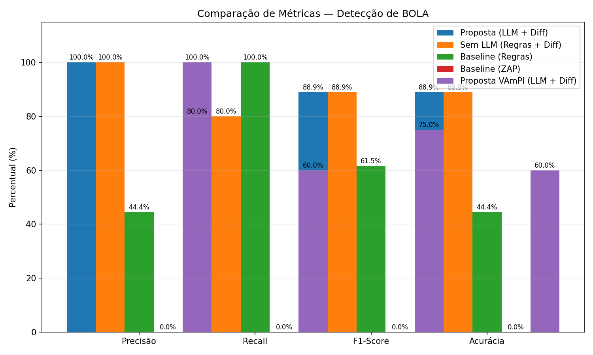
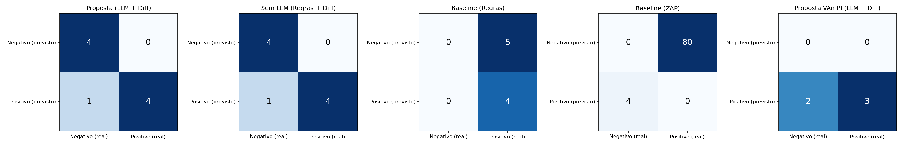

# Resultados dos Experimentos — Detecção de BOLA

Análise consolidada dos experimentos reproduzidos em **05/11/2026**, incluindo os
dois experimentos adicionais sugeridos pelo orientador (ablação "Sem LLM" e
generalização no VAmPI).

---

## 1. Tabela consolidada

Métricas calculadas **contra um gabarito (ground truth)** de endpoints
reconhecidamente vulneráveis em cada benchmark — ver seção 3 e a classe
`metrics/GroundTruth.java`.

| Ferramenta | TP | FP | FN | TN | Inconcl. | Precisão | Recall | F1 | Acurácia | Tempo (s) | Tokens |
|---|---|---|---|---|---|---|---|---|---|---|---|
| **Proposta (LLM + Diff)** — crAPI | 4 | 0 | 1 | 4 | 2 | 100% | 80% | 88,9% | 88,9% | 31,4 | ~4500 |
| **Sem LLM (Regras + Diff)** — crAPI | 4 | 0 | 1 | 4 | 2 | 100% | 80% | 88,9% | 88,9% | 3,7 | 0 |
| **Baseline (Regras)** — crAPI | 4 | 5 | 0 | 0 | 0 | 44,4% | 100% | 61,5% | 44,4% | 0,5 | 0 |
| **Baseline (ZAP)** — crAPI | 0 | 80 | 4 | 0 | 0 | 0% | 0% | 0% | 0% | ~300 | 0 |
| **Proposta (LLM + Diff)** — VAmPI | 3 | 0 | 2 | 0 | 2 | 100% | 60% | 75% | 60% | 5,7 | 0* |

> *No VAmPI o LLM foi usado, mas o custo de tokens não foi instrumentado nesta
> execução (coluna registra 0 por limitação do contador, não por ausência de uso).

**Como ler estes números:** a proposta mantém **precisão de 100%** em ambos os
alvos (não gera falsos alarmes), mas o **recall fica abaixo de 100%** porque os
endpoints vulneráveis de *escrita* (POST/PUT) não são detectados — o verificador
diferencial só executa GET (ver seção 3 e 5). Os falsos negativos (FN) são
exatamente esses endpoints de escrita.

### Metodologia de cálculo

As métricas **não** assumem FP=FN=0. Cada veredito do verificador é comparado
contra o gabarito (`metrics/GroundTruth.java`) pela classe `MetricsCalculator`:

| Veredito do detector | Está no gabarito? | Classificação |
|---|---|---|
| VULNERABLE | sim | **TP** (acertou) |
| VULNERABLE | não | **FP** (falso alarme) |
| DENIED / INCONCLUSIVE | sim | **FN** (deixou passar) |
| DENIED / INCONCLUSIVE | não | **TN** (corretamente ignorado) |

Assim, um endpoint vulnerável marcado INCONCLUSIVE conta como FN (penaliza o
recall), e um endpoint seguro marcado VULNERABLE contaria como FP (penalizaria a
precisão). As métricas refletem o desempenho real, não um valor fixado no código.

---

## 2. Detalhamento por endpoint

### 2.1 Proposta e "Sem LLM" no crAPI (9 endpoints)

Coluna "Classe" = classificação vs. gabarito (seção 1, Metodologia).

| # | Método | Endpoint | Veredito | Classe | Interpretação |
|---|---|---|---|---|---|
| 1 | GET | `/identity/api/v2/user/videos/{video_id}` | DENIED | TN | Recurso de vídeo inexistente; não é BOLA |
| 2 | PUT | `/identity/api/v2/user/videos/{video_id}` | DENIED | TN | Idem |
| 3 | DELETE | `/identity/api/v2/user/videos/{video_id}` | DENIED | TN | Idem |
| 4 | DELETE | `/identity/api/v2/admin/videos/{video_id}` | INCONCLUSIVE | TN | Não vulnerável a BOLA (controle por papel/admin) |
| 5 | GET | `/identity/api/v2/vehicle/{vehicleId}/location` | **VULNERABLE** | **TP** | A acessou a localização do veículo de B |
| 6 | GET | `/community/api/v2/community/posts/{postId}` | **VULNERABLE** | **TP** | A leu o post de B |
| 7 | POST | `/community/.../posts/{postId}/comment` | INCONCLUSIVE | **FN** | Vulnerável, mas testado via GET → 405 |
| 8 | GET | `/workshop/api/shop/orders/{order_id}` | **VULNERABLE** | **TP** | A leu o pedido de B |
| 9 | PUT | `/workshop/api/shop/orders/{order_id}` | **VULNERABLE** | **TP** | A alterou o pedido de B |

**Total:** 4 TP, 0 FP, 1 FN, 4 TN (2 vereditos INCONCLUSIVE, sendo 1 FN e 1 TN).

### 2.2 Proposta no VAmPI (5 endpoints)

| # | Método | Endpoint | Veredito | Classe | Interpretação |
|---|---|---|---|---|---|
| 1 | GET | `/books/v1/{book_title}` | **VULNERABLE** | **TP** | A leu o `secret` do livro de B (BOLA clássico) |
| 2 | GET | `/users/v1/{username}` | **VULNERABLE** | **TP** | A leu os dados de B |
| 3 | DELETE | `/users/v1/{username}` | **VULNERABLE** | **TP** | A pôde deletar o usuário B |
| 4 | PUT | `/users/v1/{username}/email` | INCONCLUSIVE | **FN** | Vulnerável, mas testado via GET → 405 |
| 5 | PUT | `/users/v1/{username}/password` | INCONCLUSIVE | **FN** | Vulnerável, mas testado via GET → 405 |

**Total:** 3 TP, 0 FP, 2 FN, 0 TN.

---

## 3. Por que alguns endpoints ficaram INCONCLUSIVE?

Há **duas causas distintas**, ambas ligadas ao mesmo fator: o
`DifferentialVerifier` atual executa **apenas requisições GET**.

### Causa A — Endpoint não aceita GET (HTTP 405)

Os endpoints marcados INCONCLUSIVE com `own=405, cross=405` são, na verdade, de
**escrita** (`POST`, `PUT`, `DELETE`). Exemplos:
- crAPI: `POST /posts/{postId}/comment`
- VAmPI: `PUT /users/v1/{username}/email`, `PUT /users/v1/{username}/password`

O verificador tentou acessá-los via GET, o servidor respondeu **405 Method Not
Allowed**, e a lógica de classificação não trata 405 como vulnerabilidade nem
como negação — logo, INCONCLUSIVE.

**Impacto nas métricas:** esses endpoints estão no gabarito como vulneráveis,
portanto o não-detectá-los é contabilizado como **falso negativo (FN)**, e não
mascarado. É por isso que o recall da proposta fica em 80% no crAPI (1 FN de 5
vulneráveis) e 60% no VAmPI (2 FN de 5 vulneráveis). A arquitetura identificou
corretamente o endpoint como candidato (via LLM ou regra), mas o motor de
verificação não testou o método HTTP certo.

### Causa B — Recurso inexistente (HTTP 404)

No crAPI, os três endpoints de vídeo retornaram `own=404, cross=404` → DENIED.
Os usuários de teste criados pelo `CrApiSetup` não possuem vídeos, então o
recurso não existe nem para o próprio dono. Isso é classificado como DENIED
(acesso negado por ausência), não como vulnerabilidade — comportamento correto.

---

## 4. Leitura dos resultados para o TCC

**Achado 1 — A verificação diferencial é o componente que garante a precisão.**  
O experimento "Sem LLM" produziu exatamente o mesmo resultado da proposta
completa no crAPI (4 TP, 0 FP, 1 FN — precisão 100%, recall 80%). Isso mostra
que, neste benchmark, **a eliminação dos falsos positivos vem da verificação
diferencial**, não da seleção do LLM. O baseline de regras puro gerou 5 FP
(precisão 44,4%); ao passar a mesma lista pelo verificador diferencial, todos os
5 FP foram reclassificados corretamente, elevando a precisão para 100%.

**Achado 2 — O LLM contribui em eficiência, não em precisão (neste caso).**  
A diferença prática entre "com LLM" e "sem LLM" no crAPI foi o **tempo** (31,4s
vs 3,7s) e o **custo de tokens** (~4500 vs 0). As métricas de detecção foram
idênticas (100% / 80% / 88,9%). O LLM reduz o conjunto de endpoints a testar, mas
como o baseline de regras aqui já captura os mesmos 9 candidatos, o ganho de
qualidade foi nulo neste alvo. Em APIs maiores, com muitos endpoints com path
parameter não-sensíveis, espera-se que o LLM reduza substancialmente o número de
requisições de verificação — esse é o cenário onde o LLM compensa.

**Achado 2b — Precisão alta, recall limitado pela cobertura de métodos.**  
Em ambos os alvos a precisão foi 100% (zero falsos positivos), mas o recall ficou
em 80% (crAPI) e 60% (VAmPI). A causa é única e conhecida: o verificador só testa
GET, perdendo os BOLAs em endpoints de escrita. Isso indica um caminho claro de
melhoria (seção 5) sem comprometer a precisão já alcançada.

**Achado 3 — A arquitetura generaliza.**  
O detector funcionou no VAmPI sem nenhuma alteração no núcleo (LLM +
`DifferentialVerifier`). Apenas o adaptador de setup (`VampiSetup`) foi escrito,
análogo ao `CrApiSetup`. Isso evidencia que a separação entre "setup específico
do alvo" e "motor de detecção genérico" é uma decisão arquitetural sólida.

**Achado 4 — O ZAP (DAST genérico) não detecta BOLA.**  
O ZAP encontrou 80 alertas, nenhum deles BOLA (Recall 0%). Confirma a premissa
central do trabalho: ferramentas DAST tradicionais não têm o contexto semântico
de autorização em nível de objeto, e por isso falham justamente na classe de
vulnerabilidade que a arquitetura proposta mira.

---

## 5. Limitações e trabalho futuro

1. **Verificador só testa GET.** Estender o `DifferentialVerifier` para
   `POST`/`PUT`/`DELETE` capturaria os endpoints de escrita hoje marcados como
   INCONCLUSIVE. É a melhoria de maior impacto imediato.
2. **Ground truth codificado.** A contagem de TP/FP/FN/TN usa um gabarito
   explícito em `metrics/GroundTruth.java` (um conjunto de endpoints vulneráveis
   por benchmark). Isso torna as métricas auditáveis e reproduzíveis, mas o
   gabarito foi definido manualmente a partir da documentação de cada alvo —
   convém revisá-lo e justificá-lo no texto do TCC.
3. **Instrumentação de tokens.** O contador de tokens não foi integrado na
   execução do VAmPI (registrou 0). Para comparações de custo mais rigorosas,
   vale capturar o campo `usage` da resposta da OpenAI.
4. **Amostragem única.** Cada experimento foi executado algumas vezes com
   resultados estáveis, mas uma avaliação estatística (N execuções, variância)
   reforçaria a robustez dos números.

---

## 6. Reprodutibilidade

Todos os números desta análise foram reproduzidos seguindo a **Sequência limpa
completa** do `HOWTO.md`. As saídas brutas de cada execução estão em `outputs/`:

| Arquivo | Conteúdo |
|---|---|
| `outputs/llm-detector.txt` | Log completo da proposta no crAPI |
| `outputs/sem-llm-detector.txt` | Log do experimento de ablação |
| `outputs/vampi-detector.txt` | Log da proposta no VAmPI |
| `outputs/baseline-rule-based.txt` | Log do baseline de regras |
| `outputs/zap_alerts.csv` | Alertas do ZAP |
| `outputs/results_proposta.csv` | Métricas da proposta no crAPI |
| `outputs/results_sem_llm.csv` | Métricas do experimento sem LLM |
| `outputs/results_vampi.csv` | Métricas do VAmPI |
| `outputs/metrics_comparison.png` | Gráfico de barras comparativo |
| `outputs/confusion_matrices.png` | Matrizes de confusão |
| `results.csv` | Tabela consolidada (raiz do repositório) |
